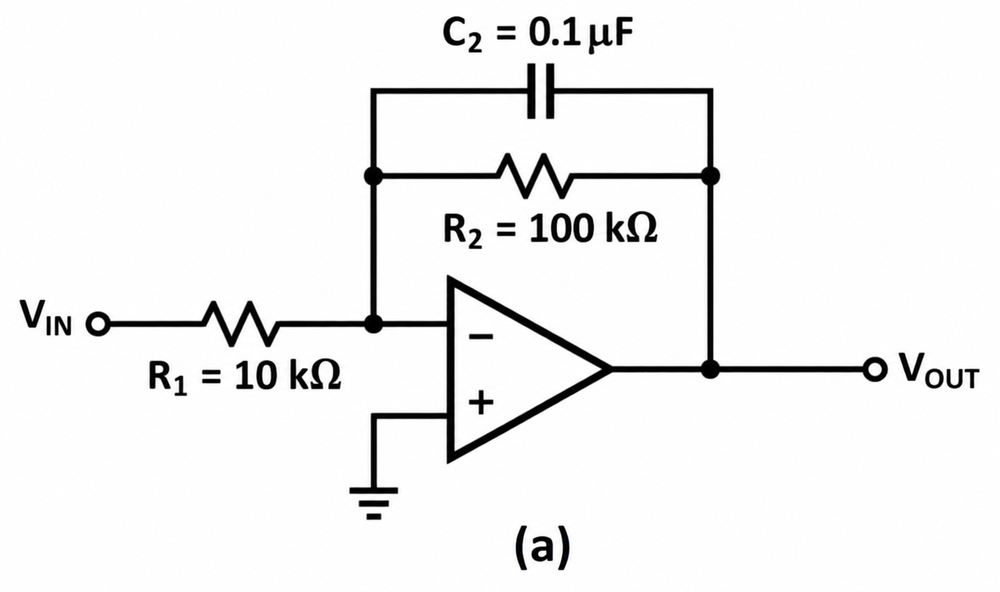
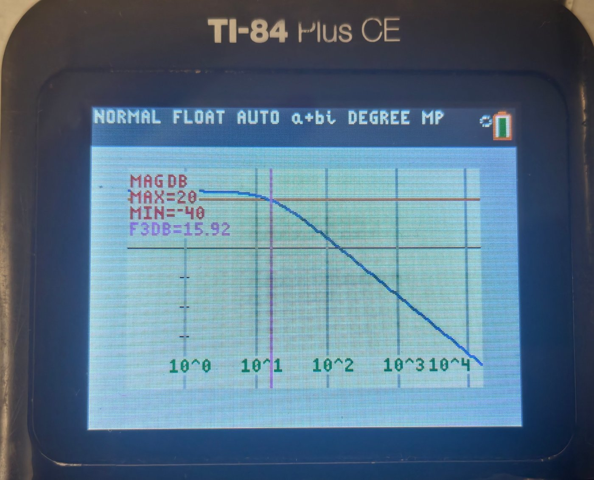
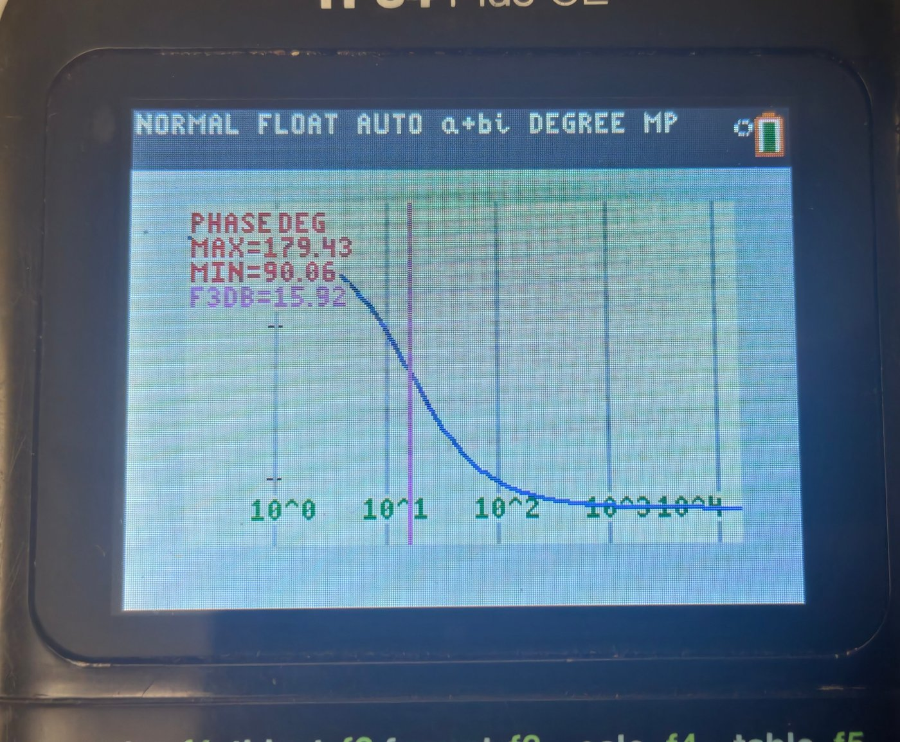
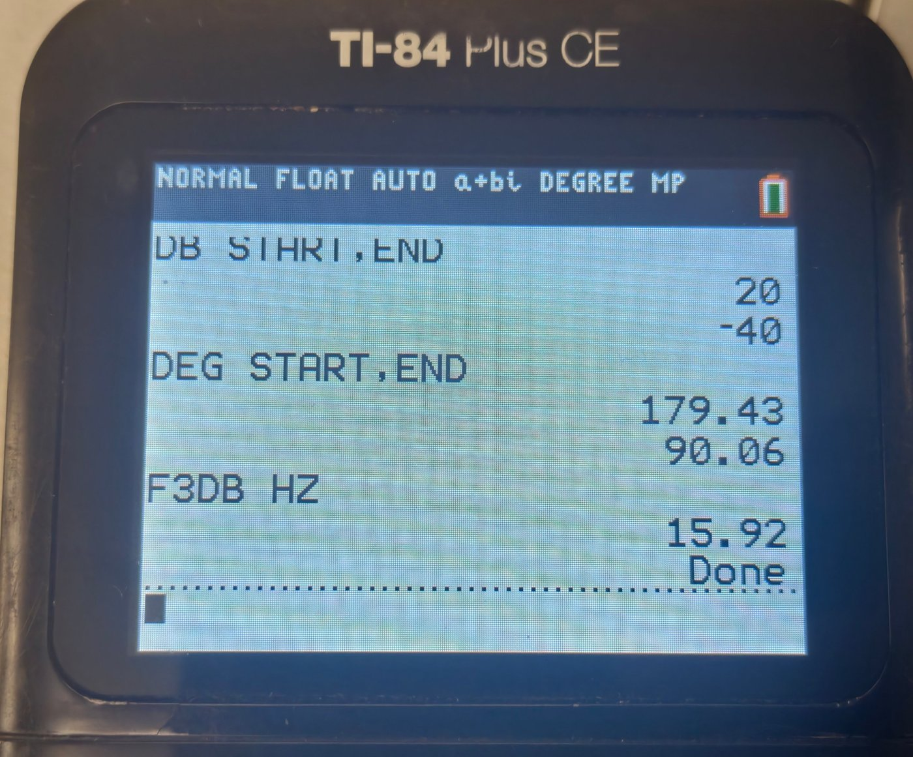
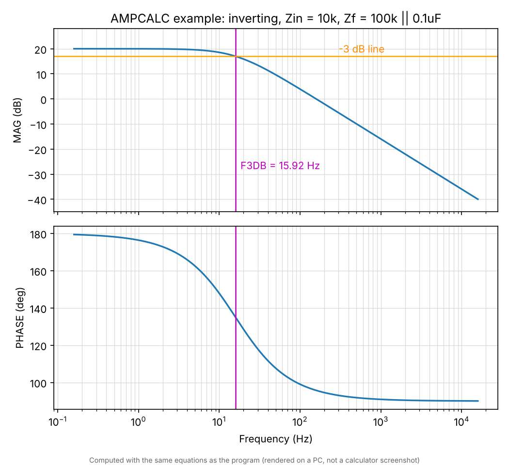

# AMPCALC — Op-amp frequency response calculator for TI-84 Plus CE

A TI-BASIC program that computes the gain, dB and phase of an **inverting** or **non-inverting** op-amp stage whose input impedance (Zin) and feedback impedance (Zf) are built from series/parallel R, L and C — for a single frequency, or as a full Bode magnitude + phase plot.

 一个 TI-84 Plus CE 上的 TI-BASIC 程序。选择反相或同相运放,用串联/并联的 R、L、C 组成输入阻抗 Zin 和反馈阻抗 Zf,即可计算单个频率下的增益、dB 和相位,或绘制幅频 + 相频 Bode 图。

---

## Features

- Inverting `H = -Zf/Zin` or non-inverting `H = 1 + Zf/Zin`
- Zin and Zf each: series R, L, C **plus** a parallel R, L, C branch (12 values in total)
- Menu-driven input with back-edit (view / re-enter any group), and a formula page showing how the result is computed
- Unit suffixes: `10K`, `4.7K`, `1UF`, `100NF`, `1NH`, `2MEG`, `P N U M K G T` (a trailing `F`/`H` is ignored)
- Single-frequency result: gain, dB, phase
- Bode plot with an auto-suggested frequency range (from detected corner/resonance frequencies) or a manual range
- Plot annotations: `10^n` axis labels, MAX/MIN, −3 dB line, and the −3 dB frequency (`F3DB`) when the response has one
- Phase unwrapping; vectorised list computation for speed

## 功能

- 反相 `H = -Zf/Zin` 或同相 `H = 1 + Zf/Zin`
- Zin 和 Zf 各包含:串联的 R、L、C,**以及**一组并联的 R、L、C(共 12 个数值)
- 菜单式输入,输错可以返回修改(查看/重新输入任意一组),并有公式页显示结果是怎么算出来的
- 支持单位后缀:`10K`、`4.7K`、`1UF`、`100NF`、`1NH`、`2MEG`,以及 `P N U M K G T`(末尾的 `F`/`H` 会被忽略)
- 单频率结果:增益、dB、相位
- Bode 图:根据检测到的转折/谐振频率自动建议频率范围,也可手动设置范围
- 图上标注:`10^n` 横轴标签、MAX/MIN、−3 dB 线,以及有 −3 dB 点时的截止频率 `F3DB`
- 相位自动展开;用列表整体运算来提速

---

## Install

1. Send `AMPCALC.8xp` to the calculator with TI Connect CE (or copy `AMPCALC.txt` into a new program in the TI Connect CE editor and send that).
2. Set **MODE** to `Degree` and `a+bi` (the program sets Degree itself; `a+bi` must be set manually).
3. `PRGM` → `AMPCALC` → `ENTER`.

> TI Connect CE tip: if the transfer fails with "Calculator is Busy", exit the running program to the home screen first.

## 安装

1. 用 TI Connect CE 把 `AMPCALC.8xp` 发送到计算器(或者把 `AMPCALC.txt` 的内容复制到 TI Connect CE 编辑器里新建的程序中,再发送)。
2. 把 **MODE** 设为 `Degree` 和 `a+bi`(程序自己会设置 Degree,但 `a+bi` 需要手动设置)。
3. 按 `PRGM` → 选 `AMPCALC` → `ENTER`。

> TI Connect CE 小提示:如果发送时提示 "Calculator is Busy",请先在计算器上退出正在运行的程序,回到主屏幕再发送。

---

## Usage

1. Choose **INVERTING** or **NON-INVERTING**.
2. `1 ENTER ZIN` and `2 ENTER ZF`: enter the six values for each (series R, L, C, then parallel R, L, C). Type `0` for anything absent.
3. `3 VIEW/EDIT` to check or correct a group, `4 FORMULA` for the equations, `5 RUN` to calculate.
4. Pick **SINGLE FREQ** or **BODE PLOT** (then AUTO or MANUAL range).

## 使用方法

1. 选择 **INVERTING**(反相)或 **NON-INVERTING**(同相)。
2. 选 `1 ENTER ZIN` 和 `2 ENTER ZF`:各输入 6 个数值(先是串联的 R、L、C,再是并联的 R、L、C),没有的元件输入 `0`。
3. `3 VIEW/EDIT` 用来检查或修改某一组数据,`4 FORMULA` 查看公式,`5 RUN` 开始计算。
4. 选择 **SINGLE FREQ**(单频率)或 **BODE PLOT**(Bode 图),Bode 图再选 AUTO(自动)或 MANUAL(手动)范围。

---

## Example

Inverting RC low-pass: `Zin = R1 = 10K`, `Zf = R2 ∥ C2 = 100K ∥ 0.1UF`

The calculator asks for one value per line. For ZIN enter `10K`, then `0` for the other five; for ZF enter `0, 0, 0` (series R, L, C), then `100K`, `0`, `0.1UF` (parallel R, L, C).

| Quantity | Expected | Program |
|---|---|---|
| Low-frequency gain | −R2/R1 = −10 (20 dB) | 20 dB |
| fc = 1/(2π R2 C2) | 15.92 Hz | F3DB = 15.92 |
| Phase | 180° → 90° | 179.43° → 90.06° |

Magnitude plot on the calculator (grey vertical lines: decades, orange: −3 dB level, purple: F3DB):

Phase plot:

Summary page:

The same Bode plot rendered on a PC with the same equations, for reference (not a calculator screenshot):

## 示例

反相 RC 低通电路:`Zin = R1 = 10K`,`Zf = R2 ∥ C2 = 100K ∥ 0.1UF`

计算器每行只要求输入一个数值。ZIN:先输入 `10K`,其余五项都输入 `0`。ZF:先输入 `0, 0, 0`(串联 R、L、C),再输入 `100K`、`0`、`0.1UF`(并联 R、L、C)。

| 项目 | 理论值 | 程序结果 |
|---|---|---|
| 低频增益 | −R2/R1 = −10(20 dB) | 20 dB |
| fc = 1/(2π R2 C2) | 15.92 Hz | F3DB = 15.92 |
| 相位 | 180° → 90° | 179.43° → 90.06° |

计算器上的幅频曲线(灰色竖线:十倍频,橙色线:−3 dB 位置,紫色:F3DB):

相频曲线:

结果汇总页:

下面是在电脑上用同样公式画出的同一条 Bode 曲线,仅作对照(不是计算器截图):

---

## Notes and limits

- `F3DB` is only meaningful when the response is flat and then drops/rises by 3 dB. For monotonically falling/rising responses or notch/resonance circuits it is just the first point 3 dB away from the start value.
- Ideal op-amp (infinite gain, no bandwidth limit); ideal R, L, C.
- Auto range extends two decades beyond the detected corner frequencies, up to 300 points; large ranges take about a minute to draw. Use MANUAL to reduce the number of points.
- Uses lists `L₁`–`L₆` and single-letter variables, so it will overwrite them.
- The Bode plot draws with `Line(` and uses colours via `TextColor(` / coloured `Vertical`, so it needs a colour **CE** model.

## 注意事项与限制

- `F3DB` 只有在曲线先平坦、再下降/上升 3 dB 时才有意义。对于单调下降/上升的响应,或陷波/谐振电路,它只是第一个与起点相差 3 dB 的点。
- 按理想运放计算(增益无穷大、无带宽限制),R、L、C 也按理想元件处理。
- 自动范围会在检测到的转折频率两侧各多取两个十倍频,最多 300 个点;范围很大时绘图大约需要一分钟。可以用 MANUAL 手动减少点数。
- 程序会使用列表 `L₁`–`L₆` 和单字母变量,因此会覆盖它们原有的内容。
- Bode 图使用 `Line(` 绘制,并用 `TextColor(` 和带颜色的 `Vertical` 上色,所以需要彩屏的 **CE** 型号。

---

## Files

- `AMPCALC.8xp` — program for the calculator
- `AMPCALC.txt` — readable source (for the TI Connect CE editor)
- `images/` — circuit diagram and example plots

## 文件说明

- `AMPCALC.8xp` — 可直接发送到计算器的程序
- `AMPCALC.txt` — 可读的源码(用于 TI Connect CE 编辑器)
- `images/` — 电路图和示例图

---

## License

MIT

## 许可证

MIT 协议
